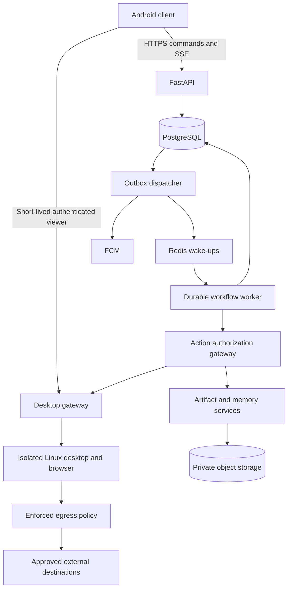

# AgentOS MVP Implementation Plan

> **For agentic workers:** Execute this technical plan one subsystem at a time. Use the repository's public-contract red-green-refactor workflow. Keep implementation inline unless the user authorizes delegation. Detailed code changes must follow the contracts and acceptance cases below.

**Goal:** Deliver an installable Android client and self-hosted cloud agent that demonstrate autonomy, persistence, visibility, and user control on supported workflows.

**Architecture:** Use a modular FastAPI service and a separate durable worker. PostgreSQL owns task state, events, approvals, execution records, and scheduling intent. A restricted computer worker supplies the actual desktop; an independent gateway authorizes tool actions and arbitrates all desktop input.

**Tech Stack:** Kotlin, Compose, Material 3, Python, FastAPI, LangGraph, PostgreSQL, Redis, Playwright, Linux containers, S3-compatible storage, FCM, and OpenTelemetry. Exact supported versions and image digests must be recorded in lock files during foundation work.

---

## Objective

Implement the P0 requirements of the supplied AgentOS PRD for one registered user and one active task. Prove all four product guarantees using controlled, reproducible workflows before opening broader website automation.

The workspace began empty and was not a Git repository when inspected. The source implementation is now a POC vertical slice described below; the full design remains unimplemented. The Docker image and Android debug APK have now been built; see the dated delivery update below.

## POC Build Status

The current POC source is a deliberately smaller slice. It uses a Python standard-library HTTP server and SQLite because this build environment could not resolve PyPI packages. The Android client uses Kotlin and Compose. It supports owner login, a revocable session, task submission and history, five-second foreground task refresh, queue-level pause/resume/cancel controls, and a single-process background worker for read-only public web research. The worker can save cited Markdown reports as owner-scoped artifacts, which the Android Files destination can list, open, and save through Android's system document picker.

The worker uses OpenAI's Responses API when `OPENAI_API_KEY` is configured. It has only the built-in web search tool, sends user task text to OpenAI, does not use the Linux computer or browser automation, and performs no external write actions. It limits each owner to five queued tasks and twenty task creations per rolling 24 hours. A worker restart fails interrupted tasks rather than retrying automatically. This remains a POC and does not implement the full cloud-agent MVP: real desktop provisioning/viewing/takeover, approval enforcement, authenticated-site workflows, durable distributed scheduling, uploads, memory, notifications, account deletion, or multi-user access remain out of scope. The Android APK has not been compiled. Gradle 9.3.1 is cached locally, but the shell build is blocked by the sandbox's local socket restriction, and Android Studio could not fetch its configured Gradle distribution while network access was unavailable. See the repository README for run instructions and the current boundary.

## Scope

Include FR-01 through FR-12. Include real cloud desktop viewing, manual takeover, approved memory, artifact persistence, account deletion, and failure recovery. Preserve the PRD's Android platform boundaries.

Exclude FR-13 specialized workflows, FR-14 scheduling, billing, public registration, multi-agent execution, semantic retrieval, and arbitrary unapproved software installation. Job application support is not the foundation architecture.

Split delivery into independently testable subsystems: identity and API; durable tasks; approvals and tools; computer and input control; files and memory; Android and notifications; deployment and acceptance. The milestone table defines their dependencies.

## Assumptions

1. The initial operator can provide a Linux host, domain, TLS configuration, model credentials, and an FCM project before deployment testing.
2. One enabled account is provisioned through an operator command. Public signup remains disabled. Tests still use two synthetic owners to detect ownership errors.
3. One task may own execution, including while waiting for approval or user intervention. Other tasks stay queued until it terminates or the user explicitly cancels it. Changing this behavior requires a scheduling decision.
4. PostgreSQL is authoritative. Redis carries wake-ups and may lose or duplicate messages without losing task state.
5. A network connection is necessary for Android control. Closing Android has no scheduling effect.
6. The engineering estimate is provisional. The week-one spikes determine whether the PRD's 8–10 weeks is credible for the actual team.
7. Configuration values below are proposed pilot defaults, not measured capacity or agreed commercial limits.

### Proposed defaults for the eight open product decisions

| Decision | Pilot proposal | Validation or override |
|---|---|---|
| Model provider | One provider behind a structured-tool adapter; deterministic fake in tests | Select the production provider after the same task-quality and cost evaluation. No automatic fallback during consequential execution. |
| Idle compute | Stop after 15 minutes with no execution or connected manual controller | Waiting tasks remain durable. Checkpoint before shutdown. |
| Workspace | 5 GiB quota; 25 MiB upload limit | Quota is reserved atomically. Limit streamed downloads and generated artifacts too. |
| Retention | Keep user files until explicit deletion; task/event content for 90 days; logs for 14 days; backups for 30 days | Show this policy in Settings. Expiration jobs remove content and stale object versions. |
| Browser sessions | Ephemeral by default | Encrypted profile persistence requires a separate opt-in design and recovery test. |
| Desktop streaming | Spike a VNC-to-authenticated-WebSocket viewer embedded in a restricted Android WebView | Compare with native RFB on real Android touch, keyboard, orientation, and reconnect behavior before selecting. |
| Domains and actions | Public research plus explicitly supported domain adapters; deny internal networks | Authenticated automation needs an adapter with enforceable action boundaries. Unknown consequential interactions become manual work. |
| Runtime and cost | 30 minutes active execution, 100 tool calls, USD 2 estimated inference ceiling per task | Wait time does not consume active runtime. Reserve estimated model cost before each call; provider billing may differ. Exhaustion pauses with an explanation. |
| Hosting | A Linux VPS capable of browser sandboxing and egress enforcement | Measure the PRD's proposed 4-vCPU/8-GB host before choosing a provider or promising capacity. |

### Product constraints requiring explicit design treatment

An arbitrary browser click can submit data. Typing can trigger autosave. A URL can disclose private information. A shell or unrestricted Python runtime can bypass an approval service entirely.

Therefore, the pilot approval guarantee applies to enforced tool contracts and supported website workflows. An LLM risk label, URL allowlist, or HTTP-method filter alone cannot enforce the guarantee on arbitrary sites. Unsupported write-capable interactions must pause for manual control. If unrestricted autonomous browser and shell access remains mandatory, approval enforcement is an unresolved release blocker, not a solved capability.

For autonomous research, use a public browsing profile with no saved private data. Keep authenticated browsing separate. For local processing, expose approved utilities with structured arguments; run generated Python without network, credentials, host access, or direct persistent workspace writes. Publish outputs through the artifact gateway. This narrows the PRD's restricted-shell requirement and must be visible in pilot documentation.

## TDD Plan

### Required workflow for every changed behavior

- [ ] Review the existing public behavior test for the requirement; extend it when it already covers the contract.
- [ ] Check that the next test expresses one business outcome or security invariant through HTTP, persisted observable data, a controlled external service, or Android UI.
- [ ] Write that one test and run it. Confirm a meaningful assertion failure caused by missing behavior, not a broken fixture or import.
- [ ] Implement the minimum behavior and run the test again.
- [ ] Run the relevant subsystem suite; refactor only as needed and rerun it.
- [ ] Commit the focused change after the green run. Do not accumulate failing tests.

Do not assert private helper calls, dependency wiring, concrete orchestration classes, or exact internal call order. Use an HTTP test website to count submissions and prove externally visible behavior. Use a fake model to issue deliberate unsafe requests. Reserve live-model evaluations for a separate non-deterministic acceptance run.

Behavior-preserving changes use existing tests. Performance changes first capture a repeatable workload and baseline; report before/after results and complexity. Prefer keyset pagination and bounded event reads. Keep cyclomatic complexity at or below 10 using the configured analyzer.

### Ordered observable behaviors

| Order | Public boundary and test location | One-cycle outcomes, implemented separately |
|---|---|---|
| 1 | HTTP: `backend/tests/api/test_auth.py` | Correct login; incorrect login; throttling; refresh rotation; revoked refresh rejection; logout; expired access rejection; account disabled rejection |
| 2 | HTTP: `backend/tests/api/test_ownership.py` | Anonymous denial; other-owner task denial; other-owner file denial; other-owner approval denial; viewer ownership denial |
| 3 | HTTP: `backend/tests/api/test_tasks.py` | Create and retrieve; duplicate request returns same task; changed duplicate payload returns conflict; second task stays queued; pause; resume; cancel |
| 4 | HTTP/SSE: `backend/tests/api/test_events.py` | Ordered durable events; replay from cursor; duplicate-safe reconnect; stale cursor response; history after process restart |
| 5 | Worker/API: `backend/tests/integration/test_recovery.py` | Queue redelivery; safe read retry; worker fencing; no blind sensitive-action retry; uncertain action exposes reconciliation state |
| 6 | HTTP/external fixture: `backend/tests/integration/test_approvals.py` | No submission before approval; correct payload executes once; edit invalidates approval; expired, rejected, consumed, revoked, and concurrent replay each fail safely |
| 7 | Worker network boundary: `backend/tests/integration/test_tool_policy.py` | Unknown tool denied; internal address blocked; redirect blocked; DNS rebinding blocked; shell escape denied; malicious page cannot approve actions or write trusted memory |
| 8 | Desktop gateway: `backend/tests/integration/test_control.py` | View-only input rejected; takeover drains in-flight input; stale agent input rejected; stale user input rejected; lost controller leaves automation paused; release requires reinspection |
| 9 | HTTP/storage: `backend/tests/integration/test_files.py` | Upload and download; quota failure; unsupported type rejection; traversal and symlink escape rejection; persistence after worker restart; approved important-file deletion |
| 10 | HTTP: `backend/tests/api/test_memory.py` | Approved fact reused; correction; deletion; untrusted source rejected; cross-owner denial |
| 11 | Android UI: `android/app/src/androidTest/java/dev/agentos/` | Login; streamed chat; offline/reconnect state; approval review; touch takeover; file retrieval; notification deep link; accessible primary navigation |
| 12 | Deployment: `acceptance/tests/` | Scenarios A–D; deletion across stores; backup restore; revoked viewer disconnection; desktop private-port isolation; budget exhaustion |

Each item separated by a semicolon is a separate cycle unless an existing test already covers it.

## Security Review

### Standards and category naming

The supplied AGENTS instructions use several category numbers that differ from the published OWASP Top 10:2025. Preserve the supplied checklist below, but use official identifiers in implementation comments and security reports. The published list includes Software or Data Integrity Failures and Mishandling of Exceptional Conditions. [Official OWASP list](https://top10.owasp.org/2025/).

| Supplied checklist category | Applicability, threat, control, and public test | Official 2025 mapping |
|---|---|---|
| A01 Broken Access Control | Applies to every owned record and input channel. Enforce owner filters, capabilities, approval payloads, and execution fencing. Test cross-owner access and stale control. | A01 |
| A02 Security Misconfiguration | Applies to containers, reverse proxy, viewer, and API errors. Keep private ports closed, enforce TLS, disable debug, and fail startup without secrets. Probe deployment ports and error responses. | A02 |
| A03 Software Supply Chain Failures | Applies to packages, worker images, and CI. Lock dependencies, pin images, generate an SBOM, scan builds, and protect release credentials. Verify provenance and release gates. | A03 |
| A04 Insecure Design | Applies to tool bypass, action uncertainty, concurrency, and budgets. Gate tool effects, deny unknown capabilities, enforce limits, and reconcile uncertain outcomes. Test bypass attempts and races. | A06 |
| A05 Cryptographic Failures | Applies to passwords, tokens, profiles, backups, and credentials. Use Argon2id, authenticated encryption with managed key material, TLS, and key rotation. Test tamper rejection and secret absence. | A04 |
| A06 Identification and Authentication Failures | Applies to API, desktop, refresh, and worker channels. Use short-lived sessions, refresh rotation, server revocation, and authentication throttling. Test expired and revoked access on every transport. | A07 |
| A07 Injection | Applies to SQL, commands, generated files, and untrusted pages. Parameterize queries; use typed tool arguments, sandboxed processing, and non-executable previews. Test injection through HTTP and tool boundaries. | A05 |
| A08 Security Logging and Monitoring Failures | Applies to approvals, auth failures, control ownership, and administration. Record actor, action ID, result, and reason without payload secrets. Inspect exported audit records and redaction. | A09 |
| A09 Server-Side Request Forgery | Applies to browser traffic, redirects, downloads, and tools. Enforce destination policy at an egress boundary with resolved-address checks and network isolation. Test IPv4/IPv6, redirect, and rebinding cases. | A01; also insecure-design review |
| A10 Vulnerable and Outdated Components | Applies to Chromium, VNC, parsers, Python, and Android dependencies. Use supported locked releases, scanners, and a documented patch cadence. Block unresolved exploitable release findings. | A03 |

All ten supplied categories apply because the complete MVP crosses identity, network, storage, code execution, and deployment boundaries.

Additional official categories: A08 Software or Data Integrity Failures applies to tool results, checkpoints, release artifacts, and approval payload integrity. Validate typed serialized data and verify artifact provenance. A10 Mishandling of Exceptional Conditions applies to partial writes, timeouts, and unknown external outcomes. Roll back local transactions, fail closed on policy outages, and test interrupted actions without automatic resubmission.

### CWE review and mitigations

The [current MITRE Top 25 page](https://cwe.mitre.org/top25/) identifies the 2025 edition. The following selections use the linked MITRE entries and their Potential Mitigations sections where present. CWE-918's entry does not expose that section; the destination and network controls below are project-specific controls for its documented risk.

| CWE | Selected mitigation and AgentOS application | Public security outcome |
|---|---|---|
| [862](https://cwe.mitre.org/data/definitions/862.html), [863](https://cwe.mitre.org/data/definitions/863.html), [639](https://cwe.mitre.org/data/definitions/639.html) | Enforce business authorization server-side on every resource access. Bind IDs to the authenticated owner; bind input to its controller and generation. | Another owner cannot access tasks, files, approvals, or desktop; guessed IDs grant no rights. |
| [306](https://cwe.mitre.org/data/definitions/306.html) | Authenticate all channels, including secondary desktop and worker connections. | No unauthenticated API, stream, or desktop connection succeeds. |
| [22](https://cwe.mitre.org/data/definitions/22.html), [434](https://cwe.mitre.org/data/definitions/434.html) | Use server-generated object keys and allowlisted file types outside served application content. Validate paths and avoid following symlinks across workspace boundaries. | Traversal, symlink escapes, dangerous uploads, and oversized files fail without modifying external paths. |
| [918](https://cwe.mitre.org/data/definitions/918.html) | Block internal, loopback, link-local, metadata, and control-plane networks at the egress boundary. Validate each redirect and resolved destination, including IPv6. | A malicious page or tool cannot reach infrastructure through alternate URLs or DNS changes. |
| [78](https://cwe.mitre.org/data/definitions/78.html) | Prefer library APIs; otherwise execute fixed programs with validated argument arrays inside a restricted sandbox. | Input metacharacters cannot start a process or escape the intended utility. |
| [89](https://cwe.mitre.org/data/definitions/89.html) | Parameterize database values and use a least-privileged database role. | Crafted identifiers and text cannot change query meaning or cross ownership boundaries. |
| [79](https://cwe.mitre.org/data/definitions/79.html) | Encode for output context and avoid active HTML in previews and chat. | Uploaded HTML cannot execute in the viewer origin or obtain session credentials. |
| [502](https://cwe.mitre.org/data/definitions/502.html) | Reconstruct allowlisted typed data after validation; never deserialize executable object formats from tools or clients. | Malformed checkpoint and tool payloads fail safely without execution. |
| [20](https://cwe.mitre.org/data/definitions/20.html), [770](https://cwe.mitre.org/data/definitions/770.html) | Parse through explicit schemas and enforce per-user resource budgets. | Invalid transitions, excessive upload size, and execution exhaustion produce bounded, safe responses. |
| [200](https://cwe.mitre.org/data/definitions/200.html) | Separate privileges and sensitive compartments. Redact logs and keep credentials outside model contexts. | Tokens and private document contents are absent from errors, push payloads, and ordinary logs. |

The CWE-77 command-injection family is covered by the more specific CWE-78 control. CWE-94 code injection remains relevant if generated Python is enabled: execute it only as explicitly untrusted code in a separate sandbox with no authority to perform protected actions. Do not interpolate generated code into privileged service execution.

CWE-352 CSRF is not directly applicable to the proposed native bearer-token REST client because it has no ambient cookie authentication. The viewer still requires strict Origin checks, one-use connection tickets, and no privileged WebView JavaScript bridge. Reassess CSRF if cookie-authenticated browser endpoints are added.

The memory-safety group (CWE-787, 416, 125, 120, 121, 122) does not call for application buffer-management controls because no custom C/C++ component is proposed. It remains relevant to native browser/viewer/parser dependencies: patch and isolate those processes. CWE-476 null handling is addressed through explicit input schemas and safe errors at public boundaries rather than tests of Kotlin or Python runtime semantics.

### SSDF alignment

Use [NIST SSDF 1.1](https://csrc.nist.gov/pubs/sp/800/218/final) as the development process framework. PO.1/PO.4: document requirements and release gates. PS.1–PS.3: restrict repository and signing access, preserve release integrity and artifacts. PW.1/PW.2: review architecture and trust boundaries. PW.4/PW.7/PW.8/PW.9: evaluate dependencies, analyze code, test executable software, and set secure defaults. RV.1–RV.3: track vulnerabilities, remediate, and analyze root causes. This is an alignment plan, not a compliance certification.

When implementing a security control, add a concise comment naming its official OWASP category, control, and prevented threat. Do not label ordinary code as a control.

## Implementation Notes

### Proposed file structure

All paths below are new. Keep ownership checks in the relevant service boundary and use focused files rather than a shared miscellaneous utility module.

| Paths | Responsibility |
|---|---|
| `backend/pyproject.toml`, `backend/uv.lock`, `backend/src/agentos/app.py` | Locked backend package and API entry point |
| `backend/src/agentos/identity/{routes,service,models}.py` | Login, refresh, revocation, account lifecycle |
| `backend/src/agentos/tasks/{routes,service,state,models,events}.py` | Task commands, legal transitions, durable event queries |
| `backend/src/agentos/conversations/{routes,service,models}.py` | Messages, ownership, history, follow-up semantics |
| `backend/src/agentos/workflows/{runner,checkpoints,recovery,outbox}.py` | Graph execution, scheduling, recovery, transactional delivery |
| `backend/src/agentos/actions/{routes,policy,approvals,executions,models}.py` | Action preparation, authorization, execution ledger |
| `backend/src/agentos/tools/{contracts,browser,documents,egress}.py` | Typed approved capabilities and isolated dispatch |
| `backend/src/agentos/computers/{routes,manager,control,tickets}.py` | Lifecycle, fencing, takeover, viewer credentials |
| `backend/src/agentos/files/{routes,service,storage}.py` | File metadata, quotas, object storage, deletion |
| `backend/src/agentos/memory/{routes,service,models}.py` | User-approved memory CRUD and provenance |
| `backend/src/agentos/notifications/{routes,outbox,sender}.py` | Device tokens and reliable FCM notification intent |
| `backend/src/agentos/platform/{database,settings,audit,telemetry}.py` | Infrastructure configuration and redacted observability |
| `backend/migrations/versions/` | Versioned PostgreSQL migrations |
| `computer/{Dockerfile,entrypoint.sh}`, `computer/gateway/` | Sandbox image and sole desktop/tool input gateway |
| `android/app/src/main/java/dev/agentos/core/{network,auth,storage}/` | OkHttp, streaming, secure credentials, local cache |
| `android/app/src/main/java/dev/agentos/features/{chat,tasks,computer,files,settings}/` | Five Compose destinations, ViewModels, repositories |
| `android/app/src/main/java/dev/agentos/notifications/` | Permission handling and authenticated deep links |
| `backend/tests/{api,integration}/`, `acceptance/{fixtures,tests}/` | Public contracts and controlled end-to-end workflows |
| `infra/{compose.yaml,proxy/,policies/,backup/,restore/}` | Deployment, network policies, backup and restoration |
| `.github/workflows/{checks,release}.yml`, `docs/runbooks/` | CI, signed pilot release, operational procedures |

### Service and trust boundaries

The model gets typed tools, not database, Docker, object-store, or secret-store credentials. The API must not mount the Docker socket. A private computer manager controls worker provisioning with narrowly defined operations; its authority is separated from model execution. A local process capable of creating containers remains a privileged trust boundary even when reached through a proxy.

### Persistence and scheduling contracts

Add to the PRD model: `Session`, `RefreshToken`, `ActionIntent`, `ControlLease`, `WorkerLease`, `TaskCheckpoint`, `OutboxEvent`, `DeviceRegistration`, and `DeletionJob`.

Task records include `version`, `event_sequence`, `execution_generation`, `pause_requested`, `cancel_requested`, budget counters, and structured error codes. Event sequence is monotonic within each task; time alone is not ordering. Artifacts include size, content digest, provenance, and deletion state. Memory includes `approved_by`, `approved_at`, and source type.

Commit task state, event, and outbox intent in one database transaction. Dispatchers deliver at least once. Consumers deduplicate durable identifiers. A reconciliation scan discovers queued work even after Redis loss. A database uniqueness constraint enforces one active execution slot per user.

Worker claims include a lease and increasing generation. A replacement worker fences the old generation at the tool gateway. LangGraph checkpoints assist execution but do not authorize replay of external effects. Cancellation and pause stop new calls and wait for a bounded in-flight call; they do not undo an action already sent.

### Task-state contract

| State | Permitted next states and meaning |
|---|---|
| `CREATED` | `QUEUED`, `CANCELLED`, `FAILED` |
| `QUEUED` | `PLANNING`, `PAUSED`, `CANCELLED`, `FAILED` |
| `PLANNING` | `RUNNING`, `WAITING_FOR_USER`, `PAUSED`, `CANCELLED`, `FAILED`, `RECOVERY_REQUIRED` |
| `RUNNING` | `WAITING_FOR_USER`, `WAITING_FOR_APPROVAL`, `PAUSED`, `COMPLETED`, `CANCELLED`, `FAILED`, `RECOVERY_REQUIRED` |
| `WAITING_FOR_USER` | `RUNNING` after reinspection, `PAUSED`, `CANCELLED`, `FAILED`, `RECOVERY_REQUIRED` |
| `WAITING_FOR_APPROVAL` | `RUNNING` after authorization or replanning, `PAUSED`, `CANCELLED`, `FAILED`, `RECOVERY_REQUIRED` |
| `PAUSED` | `QUEUED` on explicit resume, `CANCELLED`, `FAILED`, `RECOVERY_REQUIRED` |
| `RECOVERY_REQUIRED` | `QUEUED` after recorded reconciliation, `CANCELLED`, `FAILED` |
| `COMPLETED`, `FAILED`, `CANCELLED` | Terminal; a retry creates a new linked task |

Reject an illegal or stale transition with `409`. Record timestamp, actor, and reason for every accepted transition. Approval rejection leaves execution blocked until the task records an alternative plan, user instruction, or cancellation. Generic resume cannot bypass an outstanding approval or uncertain external outcome.

### Approval and external-action contract

1. Prepare an immutable `ActionIntent` containing owner, task, tool and adapter version, destination, exact recipient/fields/body, attachment digests, expected resource version, and expiry. Store sensitive payload content encrypted.
2. Canonicalize the typed payload and compute SHA-256 for integrity binding. This digest is not a password hash or a bearer authorization secret.
3. Display the actual proposed destination, content, files, and consequences in Android. Do not ask users to approve only a hash or generic action name.
4. A decision endpoint verifies owner, authenticated session, expiry, current intent version, task state, and policy. Modification creates a new intent and supersedes the previous approval.
5. At execution, lock and atomically consume the authorization into a uniquely keyed execution record. Recheck cancellation, policy, ownership, payload integrity, and worker generation immediately before dispatch.
6. Where the destination supports an idempotency key, reuse the execution ID. Otherwise, an interrupted request becomes `UNKNOWN`; set the task to `RECOVERY_REQUIRED` and reconcile against the remote service or ask the user.
7. Record confirmed result evidence. Never claim exactly-once effects for an arbitrary remote website. Cancellation or revocation cannot recall an effect already committed remotely.

Approval and execution states are separate. Suggested approval states: `PENDING`, `APPROVED`, `REJECTED`, `EXPIRED`, `SUPERSEDED`, `CONSUMED`, `REVOKED`. Execution states: `PREPARED`, `DISPATCHING`, `SUCCEEDED`, `FAILED_SAFE`, `UNKNOWN`.

### Exclusive-control contract

Every browser action, terminal keystroke, direct Playwright mutation, and human input passes through the same authority check. Read-only viewing does not grant input.

Takeover moves ownership through `AGENT -> TRANSFERRING -> USER`. Stop dispatch, drain or terminate bounded in-flight operations, invalidate queued input, increment the control generation, and only then acknowledge user control. If an operation cannot be fenced, takeover remains pending with an explanation.

Use a server lease with heartbeats. Loss of user connection expires the input lease and leaves the task paused. Automation never resumes merely because a timer elapsed. Release returns to `TRANSFERRING`; reauthenticate, reinspect desktop and pending action state, discard stale locators, increment generation, and resume explicitly. Restarted workers cannot inherit user input rights.

Viewer credentials are session-scoped, short-lived, one-use connection tickets. Keep credentials out of URLs and logs. Check the live session for revocation and actively close established streams on logout or account deletion. Disable clipboard transfer and browser file-transfer channels until independently authorized. During manual login, suppress model screenshots and avoid retaining desktop recordings.

### API additions and semantics

Retain the PRD endpoints. Add these contracts:

| Endpoint | Purpose |
|---|---|
| `POST /auth/login`, `/auth/refresh`, `/auth/logout` | Account sessions and token rotation |
| `GET/PATCH/DELETE /account` | Settings and durable deletion request |
| `GET /conversations` | Paginated conversation discovery |
| `POST /tasks/{id}/reconciliation` | Record evidence resolving an uncertain outcome; no blind retry |
| `POST /computer/session`, `DELETE /computer/session` | Start and stop the personal computer safely |
| `POST /computer/viewer-ticket` | Issue authenticated streaming access |
| `POST /computer/control/heartbeat` | Renew the current user's input lease |
| `PATCH/DELETE /files/{id}` | Rename or delete through file policy |
| `GET/POST /memory`, `PATCH/DELETE /memory/{id}` | User-controlled memory |
| `POST/DELETE /devices/{id}` | Register or revoke notification delivery |

`POST /tasks` requires an `Idempotency-Key` bound to owner and request digest. Sending a task-creating message and creating the task must be transactional; the Android client must not independently create the same task again. Follow-up messages do not silently mutate an approved action. Edits invalidate its intent.

`GET /tasks/{id}/events` negotiates JSON history or SSE. SSE supplies durable event IDs and accepts `Last-Event-ID`. The client deduplicates by ID. A cursor older than retained history returns an explicit resync response; the client loads the task snapshot before reconnecting. Stream access rechecks session expiry and revocation.

Use bounded keyset pagination for tasks, conversations, events, and files. Return structured safe errors: code, human-readable message, request ID, retryability. Never include raw provider exceptions, filesystem paths, or credentials. The model's private reasoning is not a user-visible event; expose plans and concise tool summaries.

### Files, deletion, and backup semantics

The private object store is the durable file authority. A worker workspace is a hydrated cache. Commit an artifact and verify its digest before reporting success; a file existing only inside a container is not a delivered result. Persist mutable authorized workspace changes through a journal and reconcile interrupted uploads.

Do not auto-extract archives in the pilot. Allow PDF, plain text, CSV, PNG/JPEG, and DOCX after size/type validation. Disable active content and external resource loading in previews. Run document parsers separately with resource limits. Deleting an important file requires an approved intent. Renaming or moving must not bypass ownership or deletion policy.

Account deletion immediately revokes sessions, input, queued work, and API access. A durable deletion job then stops compute and removes profiles, database content, object versions, memory, devices, and external provider files that AgentOS created. Display job status without restoring normal account access. Expire backups within 30 days and reapply deletion tombstones after any restore. Explain the backup delay before confirmation.

## Delivery Tasks

These are subsystem delivery units. Within each unit, apply the single-behavior cycles above rather than writing a large batch of failing tests. The exact files and observable outcomes are defined in the structure and test tables.

### Task 1: Validate risky contracts — Week 1

Files: `docs/adr/0001-execution-authority.md`, `docs/adr/0002-desktop-transport.md`, `acceptance/fixtures/submission_site/`, `acceptance/tests/test_risk_spikes.py`.

- [ ] Define a controlled form site with an observable submission count, a slow action, and a recoverable receipt lookup.
- [ ] Prove approval blocks the submission, payload changes invalidate it, and an interrupted submission enters reconciliation without replay.
- [ ] Prove takeover rejects stale input and drains a slow action before acknowledging manual control.
- [ ] On an Android device, measure actual viewer touch, keyboard/IME, landscape, reconnect, and initial-connection latency.
- [ ] Prove unprivileged Chromium works with its sandbox enabled; reject a deployment that depends on `--no-sandbox`.
- [ ] Prove worker egress cannot reach database, Redis, manager, metadata, or host services.
- [ ] Record pass/fail evidence, selected desktop transport, supported autonomous action boundary, and revised estimate in the ADRs.

Exit: all three hard guarantees have executable evidence. If any fails, revise the architecture or pilot scope before building on it.

### Task 2: Establish identity and durable task API — Weeks 1–2

Files: backend identity/tasks/conversations/platform modules, migrations, API tests, Android core and chat modules, `infra/compose.yaml`.

- [ ] Initialize repository metadata and backend/Android build scaffolds; pin compatible supported dependencies.
- [ ] Create migrations for identity, conversations, messages, tasks, events, and outbox records with ownership foreign keys and indexes.
- [ ] Implement operator-provisioned login, Argon2id password verification, token expiry, refresh rotation, revocation, throttling, and safe errors.
- [ ] Implement transactional message/task creation, idempotency, task listing, and conversation history.
- [ ] Implement SSE replay and Android Room-backed history/cache with reconnection state.
- [ ] Exercise ownership denial using synthetic users through real HTTP endpoints.

Exit: an authenticated Android request creates one durable task and displays its history after both client and API restart.

### Task 3: Enforce action authorization — Weeks 2–3

Files: backend actions modules, tool contracts, approval integration tests, Android task approval screens.

- [ ] Implement immutable action intents and exact-payload review before enabling consequential tools.
- [ ] Implement approval decisions, expiry, supersession, atomic consumption, and audit records.
- [ ] Implement execution ledger, destination idempotency, and unknown-result reconciliation.
- [ ] Test concurrent approvals, concurrent execution attempts, cancelled tasks, revoked sessions, changed attachments, and stale resource versions separately.
- [ ] Render full action details, rejection, modification, and expiry in Android; disable optimistic execution UI.

Exit: the controlled external site receives zero unauthorized submissions and one confirmed authorized submission under duplicate delivery.

### Task 4: Add durable orchestration — Weeks 3–4

Files: backend workflows, tools, tasks state modules; recovery and policy integration tests.

- [ ] Implement task state transitions, durable scheduling intent, worker leases, generation fencing, and startup reconciliation.
- [ ] Add LangGraph planning and typed tool execution behind the authority gateway.
- [ ] Add safe-read retries with bounded attempts and deadlines; never route unknown external outcomes into generic retry.
- [ ] Add pause, resume, cancellation, runtime/tool/cost budgets, and one-active-task admission.
- [ ] Test process termination before and after checkpoint, dispatch, external receipt, and local result commit.
- [ ] Return actionable progress and artifact evidence without exposing chain-of-thought or raw secrets.

Exit: a fixture-backed research task completes after API/worker restarts; duplicate queue delivery creates no duplicate sensitive effect.

### Task 5: Deliver the isolated computer and takeover — Weeks 4–6

Files: computer image/gateway, backend computers modules, infra policies, Android computer feature, control integration tests.

- [ ] Build non-root Linux, display, Chromium, and approved utilities with read-only system paths, dropped capabilities, PID/CPU/memory limits, and private networking.
- [ ] Implement safe computer provisioning without exposing host management credentials to the API or model.
- [ ] Connect Playwright to the actual browser shown by the live desktop.
- [ ] Implement viewer tickets, read-only mode, authenticated input, control generations, revocation, heartbeat expiry, and reinspection.
- [ ] Add Android pan/zoom, pointer mapping, scrolling, keyboard/IME, connection state, and landscape behavior.
- [ ] Implement idle stop, cold restart, hydration, and clear browser-session-loss messaging.

Exit: Scenario C works on a physical device; agent and user input cannot overlap; private desktop ports are unreachable externally.

### Task 6: Complete files, memory, monitoring, and notifications — Weeks 5–7

Files: backend files/memory/notifications modules, Android files/settings/tasks features, related public tests.

- [ ] Implement file metadata, streaming uploads, atomic quota reservation, durable artifact publishing, preview policy, downloads, and approved deletion.
- [ ] Implement approved memory creation, correction, deletion, provenance, and owner-scoped retrieval.
- [ ] Complete task timelines, status filters, error recovery guidance, and artifact links.
- [ ] Add transactional notification intent, bounded FCM delivery retries, token rotation, generic lock-screen text, and authenticated deep links.
- [ ] Respect Android notification permission denial while keeping in-app events functional.
- [ ] Implement account-data deletion and retention jobs across all stores.

Exit: generated files survive worker removal; approved preferences can be corrected; closed-app notifications open the correct authorized task.

### Task 7: Harden, measure, and release — Weeks 8–10

Files: acceptance suite, CI/release workflows, infrastructure backup/restore scripts, operator runbooks.

- [ ] Run Scenarios A–D against controlled sites and a separate live-model evaluation set.
- [ ] Complete security tests, dependency/image scans, secret scans, static analysis, and permission-manifest review.
- [ ] Restore database and object storage into a clean environment; verify artifact digests and deletion tombstones.
- [ ] Measure cold start, task acknowledgement, computer startup, viewer connection, and event latency on named devices and host hardware.
- [ ] Produce a signed pilot APK, immutable backend/worker images, migration package, SBOM, and release checksums.
- [ ] Document installation, rollback, secret rotation, stalled approvals, unknown external outcomes, lost browser sessions, storage pressure, and account deletion.

Exit: every P0 requirement has acceptance evidence, known limitations, and an operator recovery path. No unresolved approval, isolation, persistence, or control guarantee remains.

Dependencies: Task 1 gates Tasks 3–5. Task 2 gates Tasks 3, 4, and 6. Task 3 gates enabling external write tools in Task 4. Tasks 4–6 gate release. Weeks overlap only where staffing and completed contracts permit it; overlap is not an assumption of parallel agents.

## Validation

### Proposed repeatable commands

These commands become runnable after the corresponding scaffold exists. They have not been run in this empty workspace.

| Command | Expected outcome |
|---|---|
| `cd backend` then `uv sync --frozen` | Install the locked backend environment |
| `uv run pytest tests/api -q` | Identity, ownership, task, event, and memory contracts pass |
| `uv run pytest tests/integration -q` | Real PostgreSQL/Redis/storage plus controlled-site recovery, policy, and control tests pass |
| `uv run ruff check .` and `uv run mypy src` | No lint/type errors; configure Ruff C901 threshold to 10 |
| `uv run pip-audit` | No unresolved exploitable dependency findings under the release policy |
| `cd android` then `./gradlew testDebugUnitTest lintDebug` | ViewModel/repository behavior and Android lint pass |
| `./gradlew connectedDebugAndroidTest` | Public UI/device tests pass on connected supported devices |
| `./gradlew assembleRelease` | Signed pilot APK built with externally supplied signing material |
| `docker compose -f infra/compose.yaml config --quiet` | Deployment configuration validates without printing secrets |
| `uv run pytest ../acceptance/tests -q` from `backend/` | Controlled end-to-end scenarios pass against an isolated deployed environment |

Integration fixtures must provision isolated services automatically and must never target the operator's production database or accounts. Live-provider tests are explicitly selected and budgeted. CI must not send messages or submit public forms.

### Release evidence

- Use at least 30 predefined controlled tasks across research/reporting, form preparation, and authenticated document retrieval. Publish the dataset, expected outcomes, environment, and run results. At least 27 must complete successfully; the controlled result does not establish reliability on arbitrary websites.
- All approval, ownership, replay, revocation, and input-fencing tests must pass. A security-test failure blocks release even if aggregate task completion exceeds 90%.
- Terminate API, worker, Redis, browser, and viewer processes at defined failure points. PostgreSQL records and committed artifacts must survive. Unknown effects must remain blocked for reconciliation.
- Record latency distributions and sample counts. Check the PRD targets without converting unmeasured targets into product claims.
- Scan dependencies and images, inspect the APK permissions, and verify private-service port exposure. A failing or unavailable required check is recorded and blocks pilot acceptance until resolved.
- No custom application-memory benchmark is required for documentation work. Benchmark the actual implementation before performance changes using a fixed event-history size, task count, artifact workload, and device/host configuration.
- External penetration testing is not performed by this plan document. A pilot security review must inspect the implemented boundaries and address findings before access expands.

### Requirement traceability

| PRD requirement | Delivery task | Acceptance evidence |
|---|---|---|
| FR-01 Authentication/account deletion | 2, 6, 7 | Session, ownership, deletion, backup-tombstone tests |
| FR-02 Conversation | 2, 4, 6 | Streaming/replay, history, follow-up, reconnect UI |
| FR-03 Planning/execution | 3, 4 | Multi-step task, cancellation, bounded failure, tool denial |
| FR-04 Computer provisioning | 1, 5 | Sandboxed real Chromium, start/stop, limits, persistence |
| FR-05 Browser automation | 1, 3, 4, 5 | Controlled research, form preparation, upload/download, tabs, safe escalation |
| FR-06 Live viewer | 1, 5 | Actual desktop, authorized reconnect, pan/zoom, landscape |
| FR-07 Takeover | 1, 5 | Exclusive input and explicit inspected return |
| FR-08 Workspace | 5, 6 | Validated files, quotas, restart persistence, retrieval, deletion |
| FR-09 Memory | 6 | Approved preferences, inspection/correction/deletion, provenance |
| FR-10 Approval | 1, 3, 4 | Payload binding, expiry, rejection, consumption, reconciliation |
| FR-11 History/monitoring | 2, 4, 6 | Durable timeline, understandable failure, artifact links |
| FR-12 Notifications | 6 | Closed-app delivery, permission handling, safe deep links |
| FR-13 and FR-14 | Excluded per PRD | No specialized-workflow or scheduler dependency |
| Android/platform/accessibility | 2, 5, 6, 7 | Five destinations, screen reader, touch targets, no Accessibility Service or broad file access |
| Deployment/security/non-functional | 1–7 | Isolation, budgets, restore, signed APK, reproducible latency and safety results |

## Completion Criteria

### This planning deliverable

- [x] Map the PRD to subsystem deliverables and public acceptance contracts.
- [x] Define task recovery, event replay, approval integrity, and exclusive control.
- [x] Record provisional product defaults, infrastructure assumptions, and unresolved engineering gates.
- [x] Review supplied security categories and reconcile them with the published OWASP list.
- [x] Define measurable pilot release evidence without claiming implementation or test success.

### MVP implementation

- [ ] A signed Android APK installs and authenticates on named supported devices.
- [ ] All five destinations operate against the deployed authenticated backend.
- [ ] Scenarios A–D complete with actual browser/desktop execution and downloadable artifacts.
- [ ] Task and file state survives client disconnection and the documented process failures.
- [ ] Protected actions cannot bypass the gateway on any enabled autonomous tool path.
- [ ] Manual and agent input are mutually exclusive across takeover, disconnect, and restart.
- [ ] Approved memory, notification permissions, deletion, quotas, and retention behave as documented.
- [ ] Security tests, deployment checks, restore tests, and reproducible success metrics pass.
- [ ] Operator documentation clearly states supported website boundaries and uncertain-action recovery.

Recommended first implementation unit: Task 1's controlled submission and approval/recovery spike, followed by identity and durable task creation. Do not defer approval authority until the PRD's week-seven safety phase.

## Delivery update — 2026-10-26

The POC now includes bounded research reflection and native Android task details. Chat/Tasks open the selected task's event timeline, current research/review stage, review issue summaries, failure recovery guidance, pause/resume/cancel controls, and accepted report link. New submissions navigate directly to task details. Polling is foreground-only and stops at terminal task states. This advances FR-11 and the monitoring portion of FR-03; it does not complete those full MVP requirements.

The Docker research/review/report flow was verified live. The Android debug APK builds with matching JVM 17 targets, and Android lint completes with non-blocking existing warnings. The build/verification environment's earlier network and local-socket restrictions have been overcome through authorized execution, so the historical POC build limitations above are no longer the current build status.

The next PRD delivery gate remains the controlled approval/execution and computer/takeover isolation spike. No external write tools, autonomous computer control, or persistent memory were enabled by this UI increment. User-approved memory remains a later requirement.

Android emulator evidence for the monitoring increment: owner login, Chat-to-task navigation, completed/review status and timeline, and direct accepted-report viewing were verified against the running Docker backend. The installed debug APK is `android/app/build/outputs/apk/debug/app-debug.apk`. Active/failure-state UI scenarios and full signed-release acceptance remain unverified.

## Approval/isolation spike update — 2026-10-26

The controlled local-inbox adapter now demonstrates immutable exact-payload approval, rejection, revision invalidation, cancellation, atomic consumption, replay/concurrent denial, and uncertain-outcome receipt reconciliation. The Android approval panel is installed and its prepare/review/approve/unconfirmed/check-receipt flow was manually verified. This is limited evidence toward FR-10; the model still has no write tool, and the gateway is not yet an independent boundary against arbitrary-code workers.

The credential-free networkless process probe passed its twelve hardening/access checks. Under the measured Docker Desktop runtime, an unprivileged user namespace returned EPERM. No actual Chromium sandbox, desktop viewer or real exclusive-input takeover was demonstrated. Those Task 1/Task 5 gates remain open; do not advance to unrestricted computer tools or represent them as complete. See ADRs 0001 and 0002 for the measured boundary and next prerequisites.
